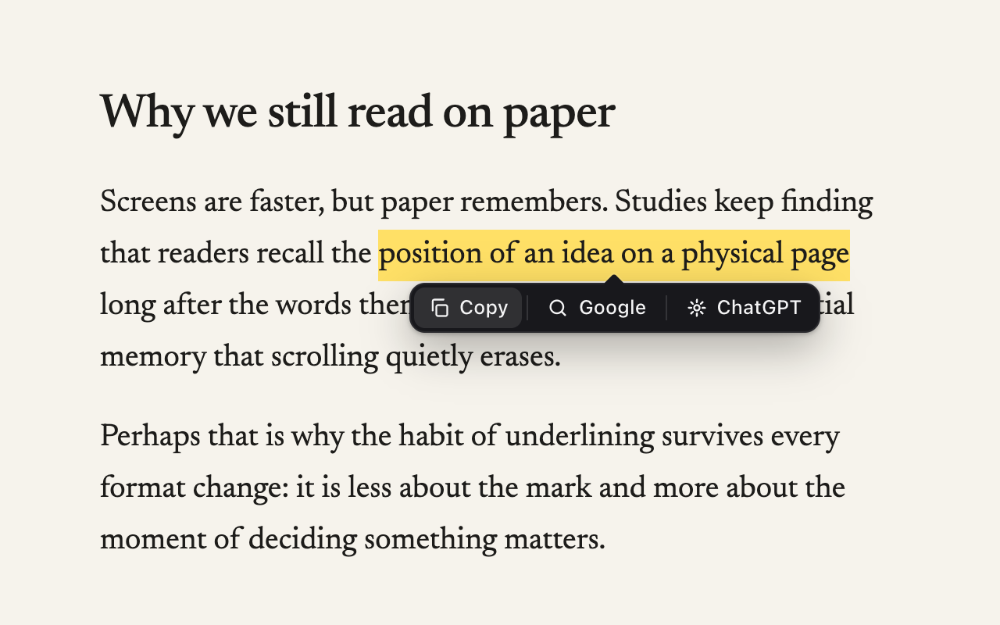

# Snipbar

Select text on any website and a small bar appears right under it with three actions: **Copy**, **Search**, and **Ask**.

Most of the time you select text because you are about to copy it or look it up. Snipbar removes the trip to the right-click menu or the address bar.



Landing page: https://avirooppaul.github.io/snipbar/

## What it does

- **Copy** puts the selected text on the clipboard and shows a brief "Copied" confirmation.
- **Search** opens the selection in a new tab on your search engine. Google by default, or DuckDuckGo, Bing, Brave.
- **Ask** opens the selection as a prompt in ChatGPT (`chatgpt.com/?q=`). Claude and Perplexity are also available.

It works on every site, inside iframes, in textareas and inputs, with mouse or keyboard selections. The bar flips above the selection when there is no room below, follows the text while you scroll, and goes away on Escape, on click, or as soon as the selection is gone.

Settings live in the toolbar popup: pick a search engine and an assistant. They sync through your Chrome profile. There is no tracking, no analytics, and no network traffic from the extension itself.

## Install

Chrome Web Store listing is not up yet, so load it unpacked:

1. Download `snipbar.zip` from the [latest release](https://github.com/AviroopPaul/snipbar/releases/latest/download/snipbar.zip) and unzip it.
2. Open `chrome://extensions` and turn on **Developer mode** (top right).
3. Click **Load unpacked** and pick the unzipped folder.
4. Select some text on any page.

Works in Chrome, Edge, Brave, Arc and other Chromium browsers.

## Develop

```sh
npm install          # Playwright for tests and icon generation
npm run verify       # headed Chromium with the extension loaded, 26 checks
npm run icons        # rasterize docs/assets/logo.svg into icons/
npm run capture      # marketing screenshots into docs/assets/
npm run zip          # snipbar.zip for a release
```

Layout:

- `manifest.json` MV3, content script on `<all_urls>`, no background worker.
- `providers.js` the search engine and assistant URL tables, shared by content script and popup.
- `content.js` selection tracking, placement, actions. The bar lives in a shadow root on a `<snipbar-host>` element.
- `popup.html` / `popup.js` engine and assistant pickers backed by `chrome.storage.sync`.
- `docs/` the landing page, served from GitHub Pages.
- `test/verify.mjs` the Playwright suite, `test/fixture.html` the page it drives.

## License

MIT
